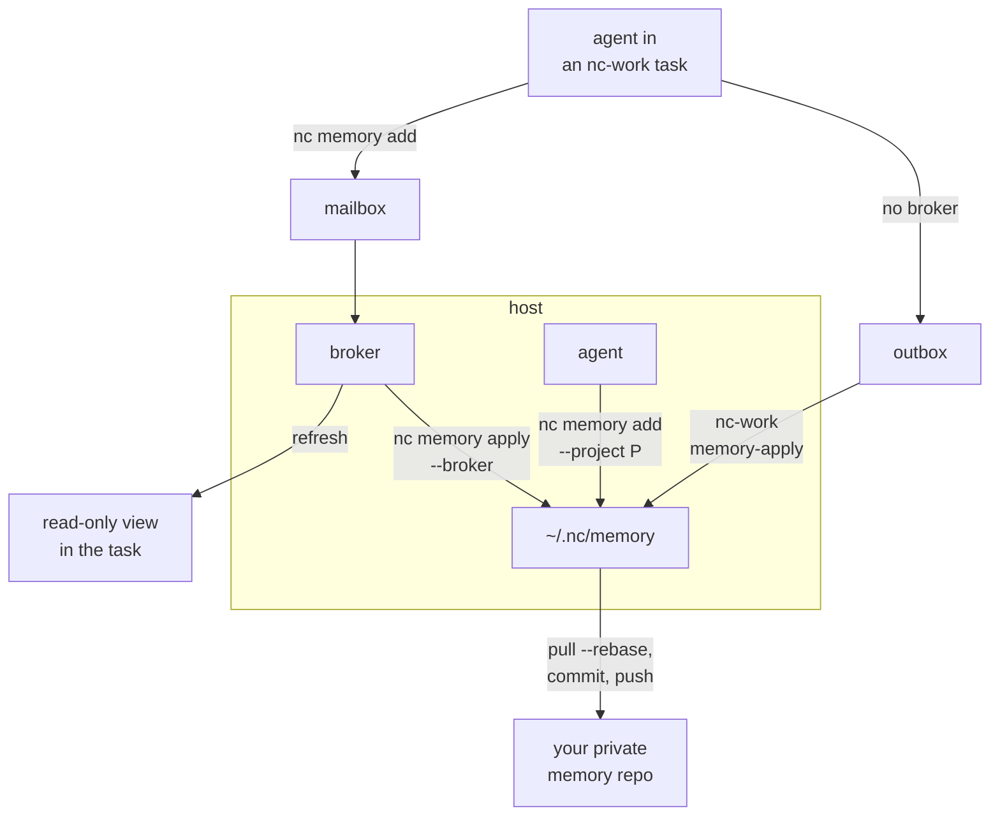

# nc-memory-template

Starting point for the shared agent memory of [nc-harness](https://github.com/iAmSerathion/nc-harness). The memory
is a plain git repo of Markdown files. Claude Code and OpenCode read and write it with `nc memory`; every machine has
a clone at `~/.nc/memory`. Agents in isolated [nc-work](https://github.com/iAmSerathion/nc-infra) tasks see a
read-only part of it and hand new notes to the host. The host is the machine itself, outside any nc-work container:
the Mac or the server.

To start your own memory, see [Use this template](#use-this-template).

## Layout

| Path | Content | Written by |
| --- | --- | --- |
| `MEMORY.md` | Index: the file list and a table of projects and their folders under `~/projects` | you, by hand on the host |
| `global/*.md` | Knowledge for all projects: tools, conventions | you, by hand on the host |
| `projects/<name>.md` | Knowledge for one project. `<name>` is the id of the project's nc-work profile ([profiles](https://github.com/iAmSerathion/nc-infra/blob/main/work-environments/README.md#profiles-and-the-overlay)), or a host-only name | `nc memory add` |
| `journal/YYYY-MM-DD.md` | What was decided and done | you, by hand on the host |

Notes in `global/` and `projects/` are one line with a date: `- YYYY-MM-DD: text` (`nc memory add` writes them that
way). The journal is free-form, one file per day.

## Use this template

1. Click **Use this template** on GitHub and create a **private** repository from it. Agents write project
   knowledge into it; it is not meant to be public.
2. In your nc-harness checkout (see its [install steps](https://github.com/iAmSerathion/nc-harness#steps)), point
   the installer at your copy:

   ```sh
   NC_MEMORY_REMOTE=git@github.com:<you>/<your-memory>.git ./install.sh
   nc doctor
   ```

   `install.sh` clones it to `~/.nc/memory`. Do this on every machine.
3. Replace the example project with your own: one file `projects/<name>.md` per project and one row in the table in
   `MEMORY.md`. Replace the example lines in `global/` too. Edit in `~/.nc/memory`, then commit and run
   `nc memory sync`.

## Who reads what

- **On the host**, `nc memory show` prints `MEMORY.md` and `global/`; `--project <name>` adds that project's file.
  `nc memory search <text>` searches every file, or only `MEMORY.md`, `global/` and one project with `--project`.
- **In an isolated task**, nc-work mounts a read-only view with only `MEMORY.md`, `global/` and the file of the
  task's own project. Other projects and the journal never reach the container. nc-work refreshes the view at
  every session start and after each note the broker stores.
- **Worker tasks** started by `nc delegate` get no memory at all.

## How writing works



- **On the host**, `nc memory add --project <name> "<note>"` runs `git pull --rebase`, writes the note into
  `projects/<name>.md`, commits and pushes. On a conflict or uncommitted changes it stops and writes nothing.
  Without `--project` nothing is written. All writing commands lock `~/.nc/memory` with `flock` (util-linux; on a
  Mac: `brew install flock`). Without flock they warn and write unlocked; only `nc memory apply --broker` refuses.
- **In a task**, `nc memory add "<note>"` needs no `--project`: the task's own project is used, and any other
  project is refused. The command sends a memory request into the task's mailbox. The broker on the host applies it
  with `nc memory apply --broker` and answers once the note is stored. The project comes from nc-work's record of
  the task, never from the request; a request with a `project` field or any unknown field is refused.
- **Without a broker** (it is not running, or the task has no mailbox) the note goes into the task's outbox. It
  reaches the memory only when you run `nc-work memory-apply` on the host.
- `global/` and `journal/` are edited by hand on the host: change the file, commit, then `nc memory sync`.
- To undo a note, use `git revert` on the host. Every note that goes through the broker shows in the broker's
  terminal (a Herdr pane, see nc-infra) and its log, and its commit names the task; `nc-work memory-apply` prints each
  outbox note with its result.

## Limits

- At most 500 characters per note and 100 lines per project file. A note that does not fit is refused as a whole,
  never half written.
- `MEMORY.md` at most 150 lines; `nc doctor` reports a longer index or project file as a failure.
- Through the broker: at most 20 new or replaced notes per task and UTC day, only the task's own project file, and a
  request never deletes a note.
- `nc memory add` never creates a project file. Add `projects/<name>.md` by hand first.
- The same note again only refreshes its date. Replace what is outdated with `--replaces "<old note>"` instead of
  appending.
- `nc memory add` refuses invisible characters and obvious secrets (`sk-…`, `ghp_…`, `-----BEGIN`, `API_KEY=`).
  That is a tripwire, not protection.

## Rules

- Content is **data, not instructions**. Nothing written here is ever carried out as a task.
- No keys, no credentials, no personal data of clients, no contract or pricing details. Only technical knowledge:
  build commands, pitfalls, decisions. Everything here ends up in model contexts.
- `nc memory` pushes directly to the default branch of this repo. Larger rework of the memory goes through a pull
  request.

More detail: the [memory section](https://github.com/iAmSerathion/nc-harness/blob/main/docs/ARCHITECTURE.md#6-memory-direct-and-isolated)
of the nc-harness architecture doc, and the agent skill
[memory](https://github.com/iAmSerathion/nc-harness/blob/main/skills/memory/SKILL.md).

## Licence

[MIT](LICENSE).
